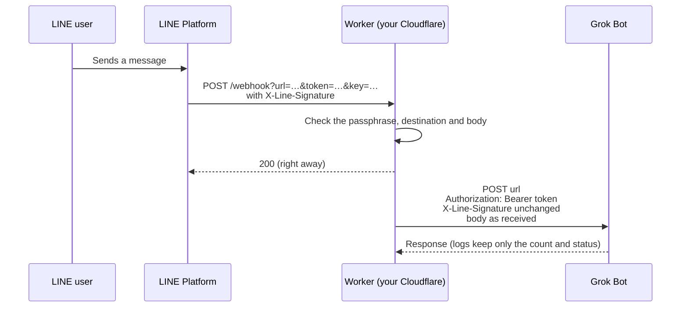
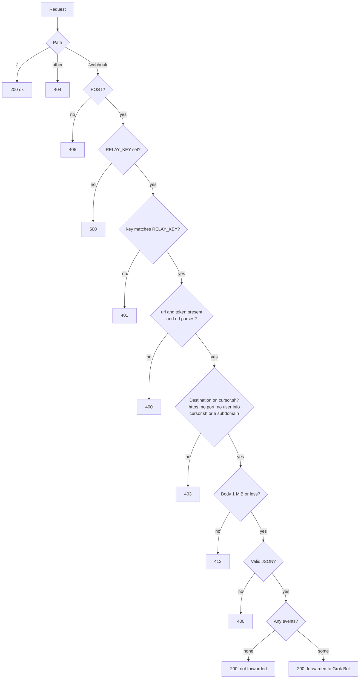

# grok-bot-harness-line

English | [日本語](README.md)

A Cloudflare Workers template that delivers webhooks from a LINE Official Account to a Grok Bot webhook.
LINE webhooks cannot carry a custom key header, so this Worker sits in between and moves the key into one.
It runs on your own Cloudflare account (the free plan is enough). Nothing passes through the author's servers.

[](https://deploy.workers.cloudflare.com/?url=https://github.com/keesmark/grok-bot-harness-line)

- It stores nothing. It passes the request body to Grok Bot as received.
- It cannot send messages to LINE and holds no channel access token.
- The only value to enter on the deploy screen is `RELAY_KEY`, a passphrase just for this Worker.

## What you need

- A LINE Official Account with the Messaging API enabled ([LINE Developers Console](https://developers.line.biz/console/))
- Your Grok Bot webhook URL and token
- A long random string for the passphrase (for example the output of `openssl rand -hex 32`)
- A Cloudflare account (the free plan is enough)
- A GitHub account (the button copies this repository into your GitHub)

## Connecting LINE

Enter the passphrase as `RELAY_KEY` on the deploy screen and deploy. Then paste the following into the Webhook URL field in the LINE Developers Console, press "Verify" and check that it succeeds.

```
https://<your Worker URL>/webhook?url=<Grok Bot webhook URL>&token=<Grok Bot token>&key=<passphrase>
```

URL-encode `url`. The Worker sends `token` as `Authorization: Bearer <Grok Bot token>` and posts the body to `url` exactly as LINE sent it.

- A Grok Bot webhook URL looks like `https://api2.cursor.sh/automations/webhook/…`.
- Only https URLs on `cursor.sh` and its subdomains are allowed as destinations (`GROK_BOT_DOMAINS` in `src/env.ts`). The path is not checked, so the Worker keeps working if the shape of Grok Bot URLs changes. Any other destination gets a 403 and nothing is forwarded.
- The token and passphrase are part of the URL, so request logs are turned off. Do not paste this URL into chats or other places.
- Requests with no events, such as the "Verify" button, are not forwarded.
- The Worker returns 200 to LINE even when the destination returns an error. LINE does not retry, so check that message in the LINE chat.

### About the LINE signature

This Worker does not verify the LINE signature. Sending a fake message to Grok Bot through the Worker requires the key (`token`), and anyone with the key can call Grok Bot directly without the Worker, so verifying here adds no protection. The `X-Line-Signature` header is passed through to Grok Bot unchanged, so Grok Bot can verify it if needed.

### About the passphrase (RELAY_KEY)

Without a passphrase, anyone who learns your Worker URL could attach their own `token` and body and make your Worker POST to `cursor.sh`, using it as a relay. To prevent this, requests whose `key` does not match `RELAY_KEY` get a 401 and nothing is forwarded. If `RELAY_KEY` is not set, the Worker returns 500 and forwards nothing.

To change the passphrase later, run the command below or change it in the Cloudflare dashboard under the Worker's Settings → Variables and Secrets, then update `key=` in the URL registered in LINE.

```sh
npx wrangler secret put RELAY_KEY
```

## Design

### Overall flow



The Worker returns 200 to LINE first and forwards to Grok Bot in the background (`ctx.waitUntil`). It stores nothing.

### Request handling



### Files

| File | Role |
| --- | --- |
| `src/index.ts` | Routes requests by path |
| `src/webhook.ts` | Handles `/webhook` and forwards to Grok Bot |
| `src/env.ts` | Allowed destinations, and building the destination from `url` and `token` |
| `src/key.ts` | Checks `key` against `RELAY_KEY` |
| `src/body.ts` | Reads the body with a size cap |

## Security

- No runtime dependencies. Development tools are pinned to exact versions with a lockfile.
- The request body is capped at 1 MiB, and reading stops once the cap is exceeded.
- Logs never include the body, the URL, or the key.

## Development

```sh
npm ci
cp .dev.vars.example .dev.vars  # set RELAY_KEY= to any value
npm test
npm run coverage
npm run dev
```

---

LINE is a trademark of LY Corporation. This repository is not an official product of LY Corporation.
