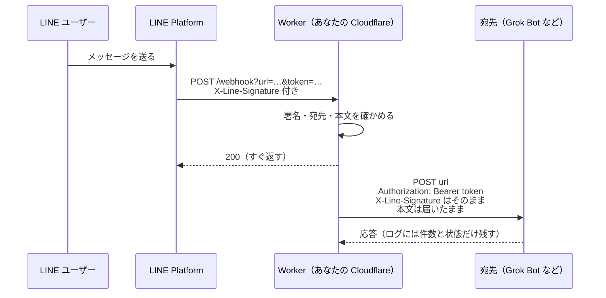
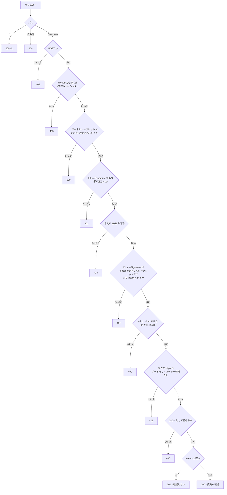

# line-webhook-relay

[English](README.en.md) | 日本語

LINE 公式アカウントの Webhook を、送信キーが要る https の Webhook（Grok Bot など）に届けるための Cloudflare Workers のテンプレートです。
LINE の Webhook は送信キーのヘッダーを付けられないので、この Worker が間に立って、キーを `Authorization: Bearer` に付け替えます。
あなた自身の Cloudflare アカウント（無料プラン）で動きます。作者のサーバーは一切通りません。

- 何も保存しません。届いた本文を、そのまま宛先に流すだけです。
- LINE へ送信する機能はありません。チャネルアクセストークンも持ちません。
- LINE の署名を確かめ、LINE から届いたものだけを流します。
- 設定する値は、LINE のチャネルシークレット `CHANNEL_SECRET` だけです。複数の LINE 公式アカウントをつなぐときは、チャネルごとに1つ足します。

> 個人が作った非公式のテンプレートです。xAI（現 SpaceXAI）や LINEヤフー株式会社とは関係がなく、提携や推奨も受けていません。Grok は SpaceXAI の商標です。LINE は LINEヤフー株式会社の登録商標または商標です。

## 準備するもの

- Messaging API が使える LINE 公式アカウント（[LINE Developers コンソール](https://developers.line.biz/console/)）
- Grok Bot の Webhook の URL と送信キー
- LINE のチャネルシークレット（LINE Developers コンソールでチャネルを開き、「チャネル基本設定」タブにあります）
- Cloudflare のアカウント（無料プランで動きます）
- GitHub のアカウント（このリポジトリを、あなたの GitHub にフォークします）

## 作り方

このリポジトリをフォークして、Cloudflare につなぎます。フォークにしておくと、あとから「Sync fork」を押すだけで更新を取り込めます。

1. [ここからフォークします](https://github.com/keesmark/line-webhook-relay/fork)。開いた画面で「Create fork」を押します。
2. Cloudflare のダッシュボードで「Workers & Pages」を開き、「作成」（Create）から「リポジトリをインポート」（Import a repository）を選びます。GitHub をつなぎ、1 で作ったフォークを選びます。フォークが一覧に出ないときは、GitHub の画面で Cloudflare のアプリにそのリポジトリへのアクセスを許可します。
3. Worker の名前は `line-webhook-relay` のままでデプロイします。`wrangler.jsonc` の `name` と違うと、ビルドが失敗します。
4. デプロイできたら、Worker の「設定」→「変数とシークレット」で `CHANNEL_SECRET` を「シークレット」として追加し、LINE のチャネルシークレットを入れます。入れるまでは、Worker は 500 を返して何も転送しません。

画面の名前は変わることがあります。見つからないときは、近い名前のものを探してください。

- フォークしたリポジトリのファイルは編集しないでください。編集すると、更新を取り込むときに衝突することがあります。
- 公開リポジトリのフォークは公開のままで、非公開にはできません。チャネルシークレットや送信キーはリポジトリには入らず、Cloudflare と LINE の設定にだけ置くので、公開でも困りません。

## つなぎ方

Worker ができたら、LINE Developers コンソールの Webhook URL に次を貼り、「検証」を押して成功を確かめます。

```
https://<Worker の URL>/webhook?url=<Grok Bot の Webhook の URL>&token=<送信キー>
```

`url` は URL エンコードしてください。Worker は `token` を `Authorization: Bearer <送信キー>` に付け替えて、本文を LINE から届いたまま `url` に流します。

- Grok Bot の Webhook の URL は `https://api2.cursor.sh/automations/webhook/…` の形です。
- 宛先は https の URL ならどこでもかまいません。http の URL、443 以外のポートを指定した URL、ユーザー名やパスワードが入った URL は 403 になり、どこにも流しません。送信キーを平文で流さないためです。
- 送信キーが URL に入るので、リクエストのログは残しません。この URL はチャットなどに貼らないでください。
- 「検証」ボタンのようにイベントが空のものは流しません。
- 流した先がエラーを返しても、LINE には 200 を返します。LINE は再送しないので、そのメッセージは LINE のチャットで確かめてください。

### LINE の署名について

LINE は、本文をチャネルシークレットで署名した値を `X-Line-Signature` ヘッダーに付けて送ってきます。Worker は届いた本文をそのまま使って署名を計算し、設定したチャネルシークレットのどれとも合わないリクエストは 401 にして、どこにも流しません。署名がないか形が違うときは、本文を読む前に 401 にします。チャネルシークレットが1つも設定されていないときは 500 を返し、何も流しません。

これで、LINE が署名した本文しか流れません。Worker の URL を知った人が、自分で作った本文と自分の `token` を付けて、あなたの Worker からどこかに POST させること（踏み台）はできません。署名と本文は宛先にも届くので、それを手に入れた人は同じ本文を Worker に送り直せます。署名は本文にしかかからないので、そのとき `url` と `token` を変えて別の宛先に送らせることもできますが、LINE が一度送った本文を繰り返すことしかできません。送信キーは LINE に設定した URL にしか入っていないので、送り直しで漏れることはありません。`X-Line-Signature` ヘッダーは、そのまま宛先にも渡します。

LINE Developers コンソールでチャネルシークレットを発行し直したときは、次のコマンドか、Cloudflare のダッシュボードで Worker の「設定」→「変数とシークレット」から、そのチャネルの `CHANNEL_SECRET`（または `CHANNEL_SECRET_<名前>`）も変えます。変えるまでは、そのチャネルからのリクエストがすべて 401 になります。

```sh
npx wrangler secret put CHANNEL_SECRET
```

## 複数の LINE 公式アカウントをつなぐ

1つの Worker に、いくつでも LINE 公式アカウント（チャネル）をつなげます。2つ目からは、次の2つを行います。

1. Worker の「設定」→「変数とシークレット」で `CHANNEL_SECRET_<名前>` を「シークレット」として追加し、そのチャネルのチャネルシークレットを入れます。`<名前>` には英数字と `_` を使い、チャネルごとに変えます（例: `CHANNEL_SECRET_SHOP`、`CHANNEL_SECRET_2`）。
2. そのチャネルの Webhook URL に、[つなぎ方](#つなぎ方) と同じ形の URL を貼り、「検証」を押して成功を確かめます。Worker の URL は同じものを使い、`url` と `token` はそのチャネルのメッセージを届けたい Grok Bot のものにします。

Worker は `CHANNEL_SECRET` と、`CHANNEL_SECRET_` で始まる名前の値をすべて使って署名を確かめ、どれか1つと合えば流します。宛先はチャネルごとの Webhook URL に入れた `url` と `token` で決まるので、Worker がどのチャネルから来たかを見分ける必要はありません。

- チャネルが1つなら、いままでどおり `CHANNEL_SECRET` だけで動きます。更新しても設定を変える必要はありません。
- `CHANNEL_SECRET` を入れずに、`CHANNEL_SECRET_<名前>` だけを使ってもかまいません。
- チャネルをつなぐのをやめるときは、そのチャネルのシークレットを削除します。

コマンドで入れるときは、名前を変えて同じように打ちます。

```sh
npx wrangler secret put CHANNEL_SECRET_SHOP
```

## アップデートのしかた

新しい版は [Releases](https://github.com/keesmark/line-webhook-relay/releases) に、変わったところと必要な作業を書いて出します。このリポジトリのページで「Watch」→「Custom」→「Releases」を選ぶと、出たときに GitHub から知らせが届きます。細かい変更は [コミットの一覧](https://github.com/keesmark/line-webhook-relay/commits/main) で見られます。ふだんは更新しても Worker の URL と `CHANNEL_SECRET` は変わらないので、LINE の設定はそのまま使えます。ただし、Worker の名前が `grok-bot-line-relay` のときは、先に [名前が line-webhook-relay に変わったとき](#名前が-line-webhook-relay-に変わったとき) を見てください。合言葉 `RELAY_KEY` を使っていたときは、先に [RELAY_KEY から移るとき](#relay_key-から移るとき) を見てください。

フォークのページで「Sync fork」→「Update branch」を押します。押す前に、取り込まれるコミットの一覧に目を通してください。取り込むと、Cloudflare が自動でデプロイします。

取り込んだら、Cloudflare で Worker の新しいデプロイが成功したことと、LINE から1通送って Grok Bot に届くことを確かめてください。うまく動かないときは、Cloudflare のダッシュボードで Worker を前の版に戻せます。戻してもリポジトリの中身は新しいままなので、次に取り込んだときにまたデプロイされます。直った更新が出てから取り込んでください。

衝突すると言われたときは、フォークのファイルを編集していたためです。[git で置き換える](#git-で置き換える) の手順で元に戻せます。

### git で置き換える

フォークの main を、テンプレートの最新のコミットに丸ごと置き換えます。フォークで変えたところは、すべて消えます。

手元に git がなければ、フォークのページで「Code」→「Codespaces」から Codespace を作り、そのターミナルで3行目から打ちます。

```sh
git clone https://github.com/<あなたの GitHub 名>/<フォークの名前>.git
cd <フォークの名前>
git fetch https://github.com/keesmark/line-webhook-relay.git main
git reset --hard FETCH_HEAD
git push --force origin main
```

Worker の名前を `line-webhook-relay` から変えていた場合は、`git push` の前に `wrangler.jsonc` の `name` を自分の Worker の名前に直してコミットしてください。直さないとビルドが失敗します。

### 名前が line-webhook-relay に変わったとき

このテンプレートは、名前を `grok-bot-line-relay` から `line-webhook-relay` に変えました。`wrangler.jsonc` の `name` も変わったので、Worker の名前が `grok-bot-line-relay` のまま更新を取り込むと、ビルドが失敗します（前の版は動き続けます）。メッセージを取りこぼさないよう、新しい名前の Worker を作ってから切り替えます。

1. [アップデートのしかた](#アップデートのしかた) の手順で、フォークに更新を取り込みます。今の Worker のビルドは失敗しますが、前の版のまま動き続けます。
2. [作り方](#作り方) の 2〜4 と同じ手順で、同じフォークから名前が `line-webhook-relay` の Worker を作ります。`CHANNEL_SECRET`（と `CHANNEL_SECRET_<名前>`）には、今の Worker と同じ値を入れます。
3. つないでいるすべてのチャネルについて、LINE Developers コンソールの Webhook URL の Worker の URL の部分を新しい Worker の URL に変えて保存し、「検証」を押して成功を確かめます。
4. LINE から1通送って宛先に届くことを確かめたら、古い Worker `grok-bot-line-relay` を削除します。

独自ドメインやルートを使っていたときは、3 の代わりに、それを新しい Worker に付け替えます。LINE の Webhook URL は変えなくてかまいません。

GitHub のリポジトリの URL も変わりましたが、古い URL は新しい URL に転送されます。

### RELAY_KEY から移るとき

以前の版は、LINE の署名の代わりに合言葉 `RELAY_KEY` と URL の `key=` で確かめていました。いまの版は `RELAY_KEY` を使わず、`CHANNEL_SECRET` がないと 500 を返します。メッセージを取りこぼさないよう、次の順に進めてください。

1. 更新を取り込む前に、Worker の「設定」→「変数とシークレット」で `CHANNEL_SECRET` を「シークレット」として追加し、LINE のチャネルシークレットを入れます。
2. [アップデートのしかた](#アップデートのしかた) の手順で更新を取り込み、デプロイが成功したことを確かめます。
3. LINE Developers コンソールの Webhook URL から `&key=<合言葉>` を消して保存し、「検証」を押して成功を確かめます。`key=` が残っていても動きますが、もう使わない合言葉を URL に残さないためです。
4. Worker の「変数とシークレット」から `RELAY_KEY` を削除します。

## 設計

### 全体の流れ



LINE には先に 200 を返し、宛先への転送はその後ろで行います（`ctx.waitUntil`）。Worker は何も保存しません。

### リクエストの判定



### ファイル

| ファイル | 役目 |
| --- | --- |
| `src/index.ts` | パスごとの振り分け |
| `src/webhook.ts` | `/webhook` の処理と宛先への転送 |
| `src/env.ts` | チャネルシークレットの読み出しと、`url`・`token` からの宛先づくり |
| `src/signature.ts` | LINE の署名の照合 |
| `src/body.ts` | 本文を上限つきで読む |

## セキュリティ

- LINE の署名（`X-Line-Signature`）を `CHANNEL_SECRET` と `CHANNEL_SECRET_<名前>` で確かめ、合わないリクエストは 401 にしてどこにも流しません。比べるときは Web Crypto の `verify` を使い、かかる時間から中身を推測されないようにしています。
- 実行時の依存はありません。開発用の道具は版を固定し、ロックファイルを入れています。
- 公開から7日たっていない版は入れません（`.npmrc` の `min-release-age=7`。npm 11.10 以降で効きます）。乗っ取られた版がすぐ見つかって消されることが多いためです。ロックファイルの版も、すべて公開から7日以上たったものです。
- 依存パッケージのインストールスクリプト（`postinstall` など）は動かしません（`.npmrc` の `ignore-scripts=true`）。乗っ取られた版が入っても、インストールの時点でコードが動かないようにするためです。この設定は `package.json` の `pretest` のような前後スクリプトも止めるので、このリポジトリでは使いません。
- 本文の大きさに上限（1MiB）をかけ、上限を超えたら読むのをやめます。
- 転送先がリダイレクトを返しても追いかけません。宛先の確認は最初の URL にしか効かないので、追いかけると、あなたが選んでいない先や http の URL に本文や送信キーが届くおそれがあるためです。
- 転送は10秒で打ち切ります。
- 転送は必ずインターネット側を通します（`wrangler.jsonc` の `global_fetch_strictly_public`）。独自ドメインをつないだときに、同じゾーンのほかのサイトへ、Cloudflare の WAF や Access を飛ばして届くことがないようにするためです。
- Worker から来たリクエスト（`CF-Worker` ヘッダー付き）は 403 にします。送り直された本文で、この Worker が自分自身に転送し続けることがないようにするためです。LINE からのリクエストには付きません。
- ログには本文・URL・送信キー・チャネルシークレットを出しません。
- 脆弱性を見つけたときは [SECURITY.md](SECURITY.md) の手順で、非公開で知らせてください。

## 開発

```sh
npm ci
cp .dev.vars.example .dev.vars  # CHANNEL_SECRET= にチャネルシークレットを入れる（2つ目からは CHANNEL_SECRET_<名前>= を足す）
npm test
npm run coverage
npm run dev
```

## ライセンス

[MIT](LICENSE)
